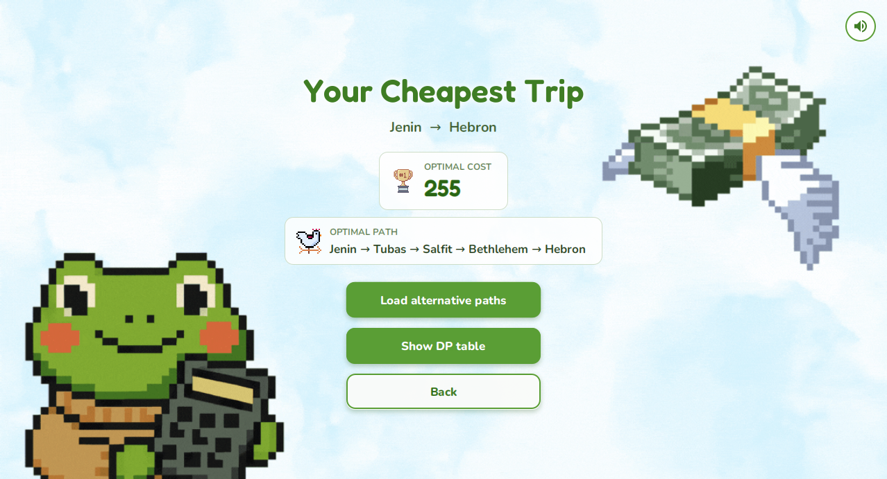
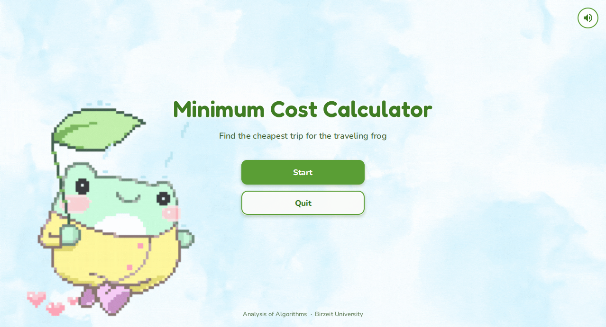
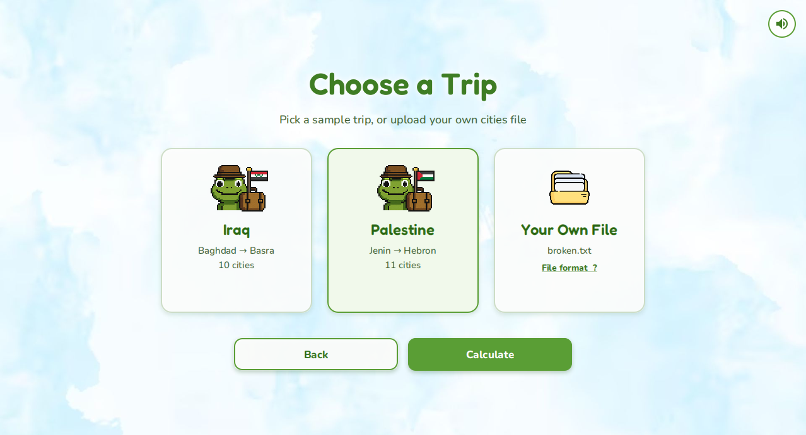
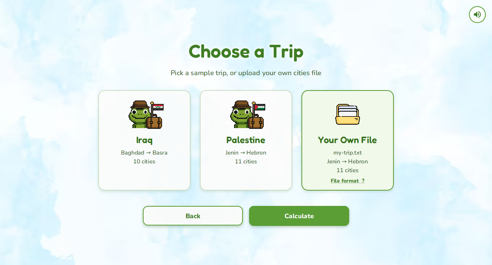
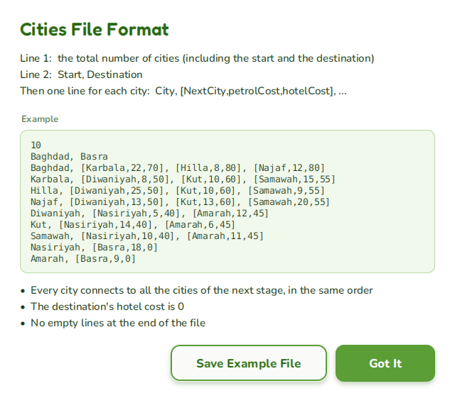
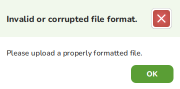
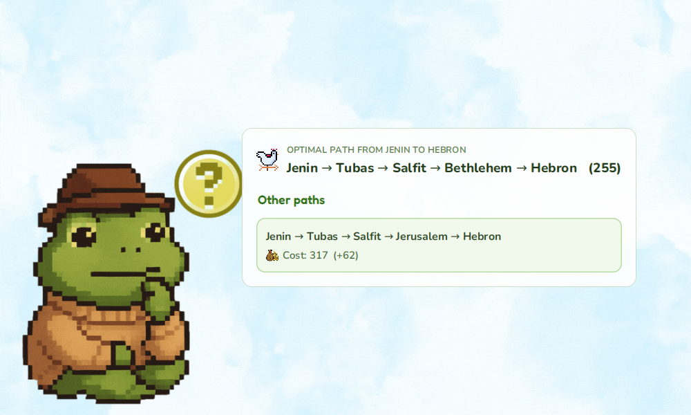
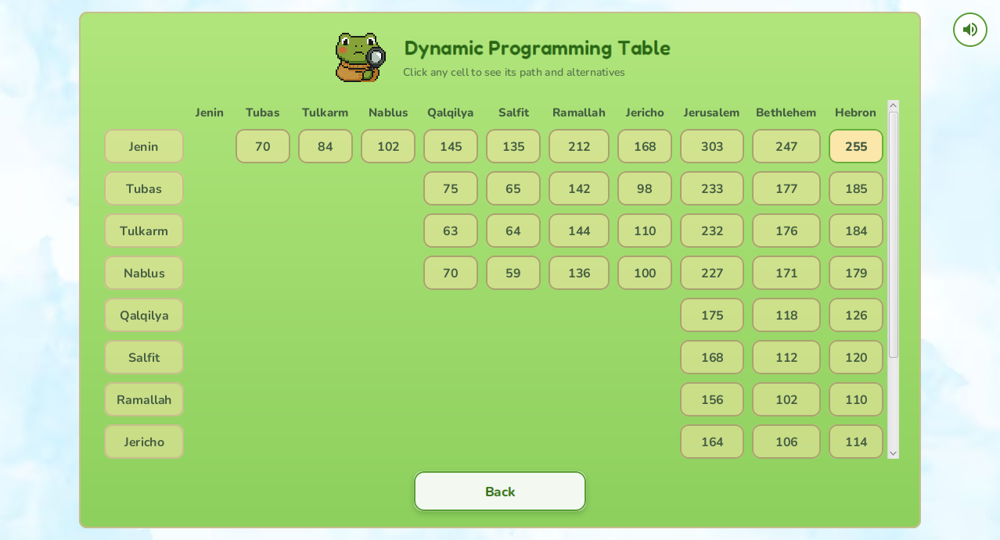
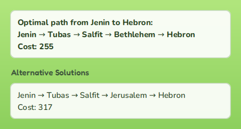

# 🐸 Minimum Cost Calculator: The Traveling Frog

A JavaFX app that uses **dynamic programming** to find the cheapest trip from a start city to a destination city.

Built as a project for the **Analysis of Algorithms** course at **Birzeit University**.



## The story

A little frog packs his suitcase and sets off on a trip. He starts in one city and wants to reach his destination, but the road runs in **stages**: each day he has to travel to one of the cities in the next stage and stay the night there.

Every move costs him money:

- ⛽ **Petrol**: the cost of driving from his current city to the next one
- 🏨 **Hotel**: the cost of sleeping in the city he arrives at

The frog is on a budget, so he wants the **route with the lowest total cost**. Trying every possible route gets slow fast, so he uses dynamic programming instead.

## How it works

Each city belongs to a stage. Moving from city `k` to city `j` in the next stage costs:

```
edge(k, j) = petrol(k → j) + hotel(j)
```

The app fills a DP table where `cost[i][j]` is the cheapest way to get from city `i` to city `j`:

```
cost[i][j] = min over every city k in the stage just before j:
             cost[i][k] + edge(k, j)
```

The answer is `cost[start][end]`. For each cell the app also stores the path and up to 3 candidate paths, so it can show you the alternatives.

## Features

- **Sample trips** built in: Iraq (Baghdad → Basra) and Palestine (Jenin → Hebron)
- Load your own trip from a `.txt` file, with a **File format** guide and an example you can save
- Show the **optimal cost** and the **optimal path**
- **Show DP table**: the full dynamic programming table, city by city
- **Load alternative paths**: other routes the frog could take, with their costs
- Error message and sound when a file is missing or in the wrong format
- Loading screen with the traveling frog while the animated backgrounds load
- Calm music-box background music, with a speaker button on every screen to turn it off

## Input file format

```
10
Baghdad, Basra
Baghdad, [Karbala,22,70], [Hilla,8,80], [Najaf,12,80]
Karbala, [Diwaniyah,8,50], [Kut,10,60], [Samawah,15,55]
Hilla, [Diwaniyah,25,50], [Kut,10,60], [Samawah,9,55]
Najaf, [Diwaniyah,13,50], [Kut,13,60], [Samawah,20,55]
Diwaniyah, [Nasiriyah,5,40], [Amarah,12,45]
Kut, [Nasiriyah,14,40], [Amarah,6,45]
Samawah, [Nasiriyah,10,40], [Amarah,11,45]
Nasiriyah, [Basra,18,0]
Amarah, [Basra,9,0]
```

| Line | Meaning |
|------|---------|
| 1 | Total number of cities, **including** the start and the destination |
| 2 | `Start, Destination` |
| 3+ | `City, [NextCity,petrolCost,hotelCost], ...` |

Rules:
- Every city in a stage connects to **every** city in the next stage, listed in the same order.
- The line count in line 1 has to be exact.
- The destination's hotel cost is `0` (the frog is home).
- No blank lines at the end of the file.

This example is included as [`cities.txt`](cities.txt), and both sample trips are in `src/main/resources/`:

| Sample | File | Optimal cost | Optimal path |
|--------|------|--------------|--------------|
| Iraq | `iraqTrip.txt` | **213** | Baghdad → Karbala → Diwaniyah → Nasiriyah → Basra |
| Palestine | `palestineTrip.txt` | **255** | Jenin → Tubas → Salfit → Bethlehem → Hebron |

## Screenshots

| | |
|---|---|
|  **Home** |  **Choose a trip** |
|  **Your own file** |  **File format guide** |
|  **Wrong file format** |  **Loading screen** |
|  **Result** |  **Alternative paths** |
|  **DP table** |  **Clicking a cell in the DP table** |

## Running it

**Requirements:** JDK 22. Maven is not needed, because the wrapper (`mvnw`) downloads it.

Make sure `JAVA_HOME` points to your JDK, then run:

**Windows (PowerShell)**
```powershell
$env:JAVA_HOME = "C:\path\to\jdk-22"
.\mvnw.cmd clean javafx:run
```

**macOS / Linux**
```bash
export JAVA_HOME=/path/to/jdk-22
./mvnw clean javafx:run
```

The first run takes a minute to download Maven and JavaFX.

## Project structure

```
src/main/java/com/example/dynamic/
├── Main.java              # Entry point, opens the window, switches screens
├── HomeScene.java         # Home screen: Start and Quit
├── LoadingScene.java      # Loading screen shown between screens
├── StartScene.java        # Choose a trip (samples or your own file), file format guide, input file parser
├── CalculationScreen.java # DP table logic, optimal cost and path screen
├── BuildTable.java        # Visual DP table and path details
├── City.java              # City: name, stage, petrol costs, hotel cost
└── NodeSolution.java      # One DP cell: cost and path
src/main/resources/        # Backgrounds, frog art, icons, sounds, music, fonts, sample trips
screenshots/               # Screenshots used in this README
```

## Built with

- Java 22
- JavaFX 22
- Maven
- Fonts: [Nunito](https://fonts.google.com/specimen/Nunito) and [Fredoka](https://fonts.google.com/specimen/Fredoka) (SIL Open Font License)
